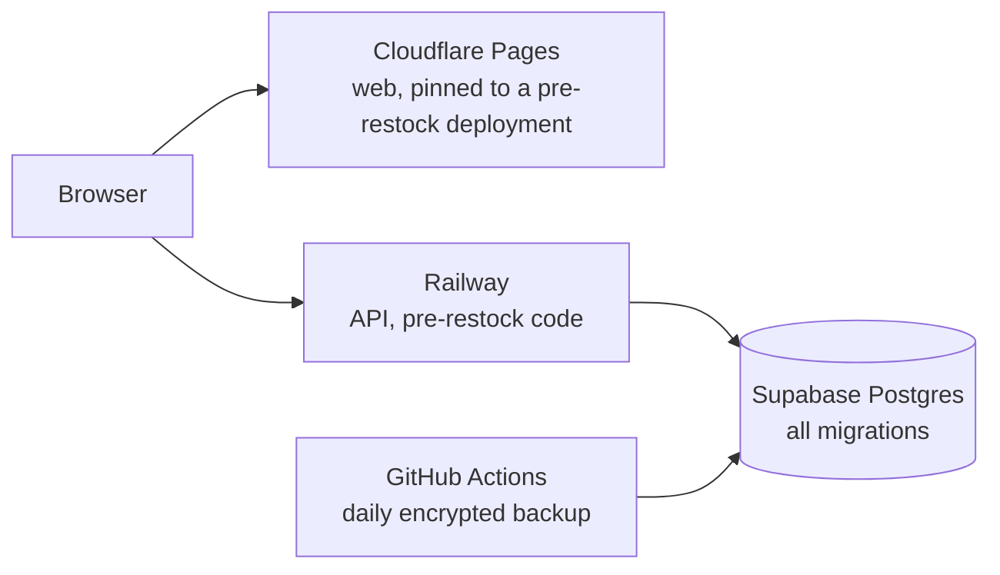
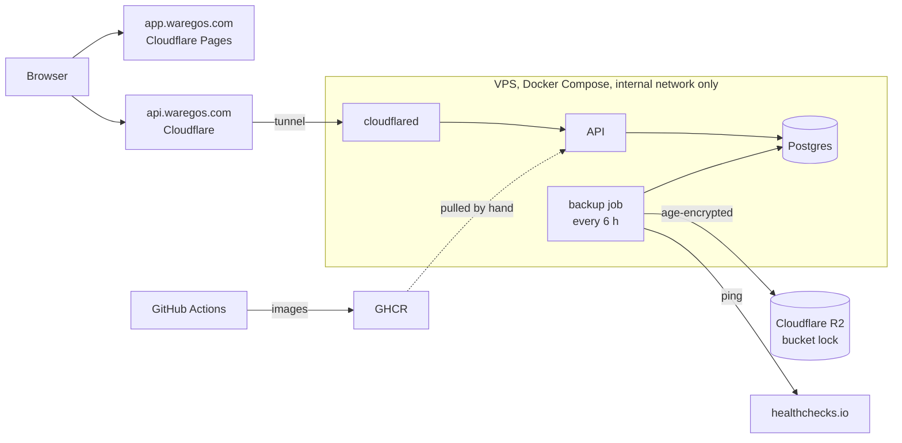

# Architecture

How Waregos is put together: where code lives, how a request flows, which domain rules the code enforces, and how it is deployed. Decisions and their reasons are in [`docs/adr/`](adr/); domain terms are in [`GLOSSARY.md`](../GLOSSARY.md).

## Folder map

```
apps/
  api/                 Fastify 5 REST API (Prisma, JWT, Zod), bundled with tsup
    src/index.ts       env validation, plugins, module mounting, /health
    src/plugins/       prisma, jwt (authenticate / adminOnly), cors
    src/modules/<name> one folder per domain area (see "API modules")
    src/shared/        response envelope, error handler, logger, pagination,
                       expiry layers, debt ledger, trust proxy, body limit (+ *.test.ts)
    Dockerfile         API image (built in GitHub Actions, pushed to GHCR)
  web/                 Next.js 16 / React 19 dashboard, static export (no server code)
    src/app/<screen>/  one folder per screen, each layout.tsx wraps AppShell
    src/components/    layout (AppShell, Sidebar), ui (shadcn/ui)
    src/lib/           api (axios), config (API URL), store (zustand auth), format, utils
packages/
  database/            Prisma schema, migrations, seed
  types/               DTOs / JwtPayload shared by api and web
  utils/               shop-timezone date boundaries, invoice numbers, input limits
deploy/                production stack for the VPS: compose.yaml, backup image, systemd, SQL roles
docker-compose.rehearsal.yml   clean-room rehearsal: empty Postgres, migrate, seed, API on :3002
scripts/               helper scripts run by hand (e.g. pulling the latest backup)
docs/                  roadmap, history, ADRs, this file
.scratch/<feature>/    specs and tickets (see docs/agents/issue-tracker.md)
```

The workspace packages ship raw TypeScript (`main: ./src/index.ts`) and are never built on their own. tsup bundles `@waregos/*` into `apps/api/dist/index.js`, and Next compiles them for the web.

## Request flow (API)

```
browser ──HTTPS──▶ Fastify
                    ├─ helmet, cors (CORS_ORIGINS), body limit
                    ├─ rate limit (per route, e.g. login)
                    ├─ preHandler: app.authenticate | app.adminOnly
                    │     re-reads the user from the DB on every request;
                    │     rejects inactive accounts and stale tokenVersion
                    ├─ <name>.route.ts   Zod safeParse → validationError on failure
                    ├─ <name>.service.ts business logic, class taking PrismaClient (+ caller role)
                    │     stock changes inside prisma.$transaction
                    ├─ ActivityService.log (audit log)
                    └─ response envelope
```

Response envelope (`shared/response.ts`):

| Case | Shape |
|---|---|
| Success | `{ success: true, data, message? }` |
| Paginated | `{ success: true, data, meta }` |
| Error | `{ success: false, error: CODE, message }` |

Services throw a module error class (`StockError`, `PurchaseError`, ...), which the route maps to a 400 with a specific code. Anything else goes to `shared/error-handler.ts`. The web shows the backend `message` first, then falls back to its own error-code map in `lib/api.ts`, so every new error code needs a good Indonesian `message`.

### API modules

| Module | Mounted at | Contents |
|---|---|---|
| `auth` | `/api/auth` | login, current user (`/me`), change password |
| `users` | `/api/users` | user management (admin) |
| `catalog` | `/api/catalog` | categories and units |
| `products` | `/api/products` | products, low stock, near expiry, dead stock, price history |
| `stock` (`purchases.*`) | `/api/purchases` | purchases and opening stock |
| `stock` (`stock.*`) | `/api/stock` | stock adjustments, cost corrections |
| `transactions` | `/api/transactions` | POS checkout and cancellation |
| `debt` | `/api/debts` | customer debt ledger |
| `reports` | `/api/reports` | summary, daily closing, monthly, top products, stock movements |
| `audit` | `/api/audit` | activity log |

Check `apps/api/src/index.ts` for the exact prefixes.

## Domain rules the code enforces

**Roles and cost visibility.** There are two roles, `ADMIN` and `CASHIER`. The role always comes from the database, never from the token. Cashiers never see cost data (buy price, unit cost, per-product profit): services take the caller's role and null out cost fields, and purchases, stock movements, top products, dead stock, price history and purchase history are `adminOnly`. The web hides admin screens, but enforcement is server-side.

**Stock.** Stock changes only through purchases, opening stock, sales and adjustments. Each change runs inside `prisma.$transaction`, updates stock atomically in SQL (never read-modify-write in JS) and writes a `StockMovement` row with `stockBefore`, `stockAfter` and, for restocks and adjustments, `unitCost`. Stock can never go negative (database constraint).

**Cost.** Product cost is a moving weighted average computed in one SQL `UPDATE` (ADR 0001). Each sale item stores its own cost, so a cost correction only affects the future.

**Immutable records.** Purchases and restocks are never edited or deleted. Mistakes are fixed with a stock adjustment (reason `EXPIRED`, `DAMAGED`, `LOST` or `CORRECTION`) or a cost correction, both visible in the audit log.

**Opening stock.** A purchase has a `kind`: `PURCHASE` (real spending) or `OPENING` (opening stock, not counted as spending) (ADR 0002).

**Expiry.** Expiry is stored per purchase line. `shared/expiry-layers.ts` allocates current stock to purchase lines newest-first (the oldest goods are assumed sold first). Stock not covered by any line is `untracked`, never guessed (ADR 0003).

**Customer debt.** An append-only ledger (`shared/debt-ledger.ts`). The balance is the signed sum of `DEBT` (+), `PAYMENT` (−) and `CANCEL` (−, a reversing entry), keyed by the normalized, case-insensitive customer name. Writes take `pg_advisory_xact_lock` on that customer inside the transaction.

**Shop time.** Day boundaries (reports, closing, invoice numbers) use the shop's timezone (WITA, UTC+8) through `@waregos/utils`, not the server's.

## Web

Everything renders client-side because of the static export: no server components, route handlers or `next/image` optimization. `lib/api.ts` is the shared axios instance; it attaches the bearer token from `localStorage` (`waregos_token`) and handles 401 globally (toast and redirect to login). The API address comes from `NEXT_PUBLIC_API_URL`, read only in `lib/config.ts` and baked in at build time. UI is shadcn/ui + Tailwind v4, Recharts for charts, sonner for toasts.

## Configuration

Each runtime has its own example file. The real files are never committed.

| File | Used by | Copy to |
|---|---|---|
| `apps/api/.env.example` | API in local dev | `apps/api/.env` |
| `packages/database/.env.example` | Prisma CLI and seed | `packages/database/.env` |
| `apps/web/.env.example` | web build | `apps/web/.env.local` (only to change the default) |
| `.env.rehearsal.example` | `docker-compose.rehearsal.yml` | `.env.rehearsal` |
| `deploy/.env.example` | production stack on the VPS | `/srv/waregos/.env` |

The GitHub Actions backup reads `PG_MAJOR`, `AGE_RECIPIENT` (repository variables) and `BACKUP_DATABASE_URL` (secret), not a `.env` file.

## Deployment

### Now (until cutover)



`main` is ahead of production. Web auto-deploy is off; production receives catalog data only. See `docs/roadmap.md` for the current state.

### After cutover (ADR 0005–0008)



- No inbound web ports and no DNS record pointing at the server. The API and Postgres are reachable only on the internal Compose network (ADR 0008).
- Images are built in GitHub Actions and tagged with the full commit SHA. Releases are manual: backup, migrate, change `API_IMAGE_TAG`, `pull && up -d` (ADR 0006, `deploy/README.md`).
- Backups are `age`-encrypted, shipped to R2 and watched by healthchecks.io; cutover is gated by a passed restore drill (ADR 0007).
